[](https://github.com/akinin/wirenboard-discovery/releases/latest)
[](https://app.keepz.me/pay?qrType=DEFAULT&receiverType=USER&receiverId=3a23e5d1-9569-425b-97c1-2a9e39fb4bd5&lng=en)

**Language: [Русский (основной)](README.md) | English**

# Wiren Board Discovery for Home Assistant

This integration connects Wiren Board devices directly to Home Assistant over MQTT. You can select individual channels, combine them into logical devices, and configure composite entities for gates, covers, thermostats, and air conditioners.

> An unofficial community integration. It is not a Wiren Board product and is not supported by Wiren Board.

This guide covers **version 0.17.3**. The screenshots use the English Home Assistant interface. Room names, device names, and entity counts will differ in your installation. The screenshots use example English device and channel names; bilingual device type labels are preserved.

## Features

- Values and metadata from Wiren Board MQTT topics under `/devices/...`.
- Channel selection during initial setup; additional channels can be added through groups.
- Standard `sensor`, `binary_sensor`, `switch`, `number`, `select`, `button`, `text`, and `datetime` entities.
- Composite `cover` entities for gates and covers, and `climate` entities for thermostats and air conditioners.
- Logical devices built from channels belonging to one or more Wiren Board modules.
- Russian and other localized names when devices publish the corresponding translations.
- Recognition of units, gas and water meters, diagnostic channels, and device errors.
- Binary sensor inversion and removal of unwanted standalone entities.
- SMS sending through a Wiren Board modem, diagnostic sensors, and a result `event` entity.
- Configuration export and import, and an MQTT diagnostics screen.

## Prerequisites

You need Home Assistant **2026.6.0 or later**, HACS, and a Wiren Board controller with an accessible MQTT broker.

Home Assistant must be able to reach the broker over the network. Have its address and port ready, along with an MQTT username and password if authentication is enabled. Devices must publish values and metadata to MQTT for their channels to be discovered; retained messages make these available immediately after connecting.

**Wiren Board Discovery does not require a separate Home Assistant MQTT integration or an MQTT bridge.** It establishes its own broker connection and can use the Wiren Board broker alongside other clients.

## Installation through HACS

The repository is included in the default HACS catalog. You normally do not need to add it as a custom repository.

1. Open **HACS** in Home Assistant.
2. Search for **Wiren Board Discovery** and open the integration by **akinin**.
3. Click **Download** and install the latest stable release.
4. Restart Home Assistant.
5. Go to **Settings → Devices & services → Add integration** and search for **Wiren Board Discovery**.

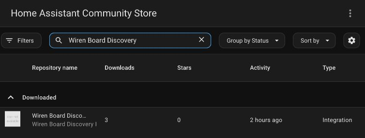

The screenshot shows an integration that has already been downloaded. Its status will differ for a new installation. If the search does not find it immediately after its inclusion in the catalog, refresh the HACS repository list and search again. As a fallback, add `https://github.com/akinin/wirenboard-discovery` through **Custom repositories**, using the **Integration** category.

### Manual installation

Download the source of the desired [release](https://github.com/akinin/wirenboard-discovery/releases) and copy `custom_components/wirenboard_discovery` into your Home Assistant configuration directory. The resulting path must be `/config/custom_components/wirenboard_discovery/manifest.json`.

If you use the release asset `wirenboard-discovery.zip`, extract its contents directly into `/config/custom_components/wirenboard_discovery/`: the integration files are at the root of this ZIP. Then restart Home Assistant and add the integration through the UI.

## Initial setup

### Adding a controller manually

Open **Settings → Devices & services → Add integration → Wiren Board Discovery** and complete the form:

| Field | Value |
|---|---|
| Controller address | The MQTT broker's IP address or DNS name, reachable from Home Assistant. Do not enter the web interface URL. |
| MQTT port | Usually `1883`; use your broker's actual port. |
| MQTT username, MQTT password | Broker credentials. Leave these empty if the broker permits the required connection without authentication. |
| Topic prefix | Usually `/`, which uses topics under `/devices/...`. Change it only if your MQTT topic layout differs. |
| Show system devices | Enable this if you want system channels available during initial selection. |

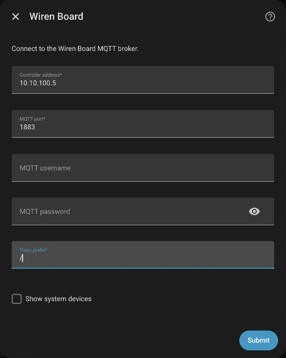

1. Click **Submit** in the connection form. The integration checks MQTT and collects available channels.
2. On **Discovered items**, select the channels you want to add to Home Assistant.
3. Submit your selection and finish the setup wizard.

For an initial check, select a few familiar channels, such as temperature, humidity, and one relay. You can add the rest later through groups. System devices are hidden by default; channels with `hidden: true` MQTT metadata are hidden separately.

If you see **This controller is already configured**, open the existing integration entry instead of adding the same connection again.

### Automatic discovery

Home Assistant can discover Wiren Board through an mDNS/Zeroconf announcement with a name such as `wirenboard-XXXX`. On **Devices & services**, click **Add** for the discovered integration, then select channels.

Automatic discovery attempts an MQTT connection on port `1883`, with prefix `/` and no username or password. Use manual setup if your broker requires authentication, uses another port, or mDNS is unavailable between your networks.

### After connecting

Selected channels appear as Home Assistant entities, grouped by Wiren Board device. Their values update over MQTT. The entities created depend on channel types, whether channels are writable, and their published metadata.

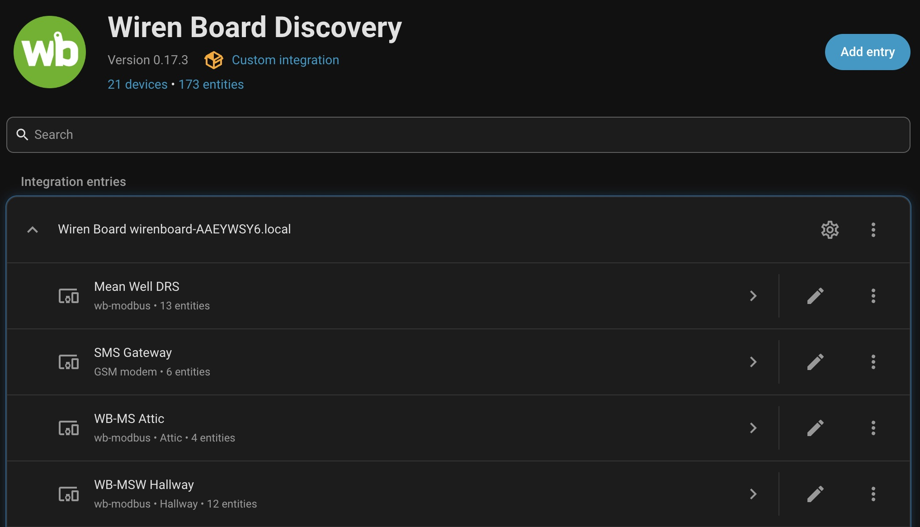

You can rename entities using Home Assistant's standard controls. The integration also uses published names, model/driver information, serial numbers, and device versions when available. It does not invent missing metadata.

## Integration options

Open the **Wiren Board Discovery** page and click the **Configure** gear icon for the required connection entry.

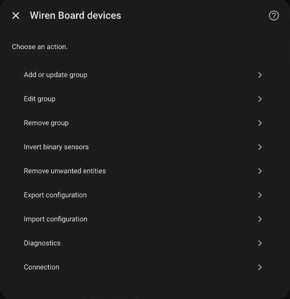

| Option | Purpose |
|---|---|
| Add or update group | Create a logical device and include channels, including previously unselected ones. |
| Edit group | Change an existing group's name, channels, type, and roles. |
| Remove group | Remove a group and deselect its channels unless other groups use them. |
| Invert binary sensors | Reverse the on and off states of selected binary sensors. |
| Remove unwanted entities | Remove selected standalone channels that are not part of any active group. |
| Export configuration | Copy the integration settings as JSON. |
| Import configuration | Replace settings with data from JSON. |
| Diagnostics | Inspect discovered devices, MQTT messages, channel types, and errors. |
| Connection | Change the MQTT address, port, credentials, and prefix. |

Saving options reloads the integration entry. A full Home Assistant restart is usually unnecessary.

## Adding channels after setup

New MQTT channels **do not create entities automatically**. The integration sees them in its current MQTT inventory, but you must explicitly select them.

There is no separate **Select items** menu option after initial setup. Use either of these options:

- **Add or update group**: create a regular device using the new channels you need.
- **Edit group**: add new channels to an existing device.

The **Group items** field supports search. A label in square brackets, such as `[Gate]`, indicates that another group already uses the channel. Moving an existing channel can change the device associated with its entity.

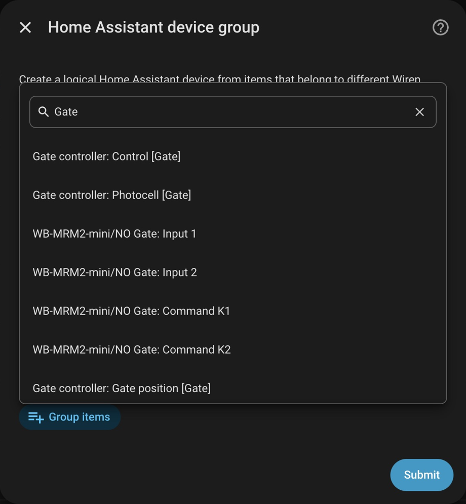

## Logical devices and composite entities

### Creating a regular device

1. Open **Configure → Add or update group**.
2. Enter a **Device name**, such as `Living room climate`.
3. Optionally set a **Group ID**, such as `living_room_sensors`. If left empty, it is derived from the name. Use a new ID for a new group: reusing an existing ID updates that group.
4. Select the **Device** type.
5. Under **Group items**, select channels from one or more Wiren Board devices.
6. Optionally set an icon and submit the form.

A regular group brings standalone entities together on one device page. Selecting a temperature channel and a setpoint does not itself create a thermostat: choose **Thermostat** and assign roles for that.

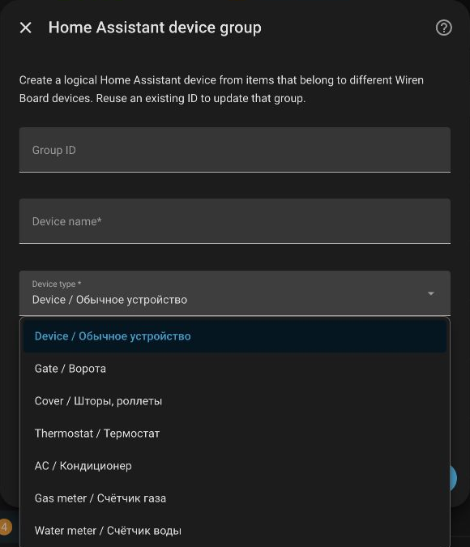

### Gates and covers

Choose **Gate** or **Cover**, enter a name, and select the required MQTT channels. The first step opens the role assignment form; the next step performs the final save.

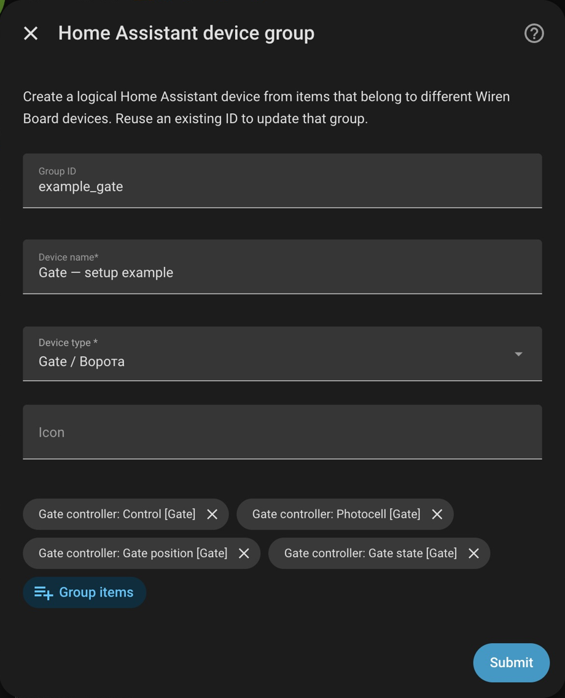

| Role | Channel to select |
|---|---|
| Command | A writable channel that controls your drive or WB rule. |
| Position | A channel reporting the actual position as a percentage, if available. |
| State | A channel reporting opening, closing, and movement. |
| Obstruction / safety | A photocell or another suitable obstruction status channel. |
| Expose as separate entities | Channels needed both within `cover` and separately, such as a photocell used in automations. |

Leave an unused role as `-`. Assigning roles does not create missing sensors: available functions depend on real channels and their values. Check command compatibility with your WB rule: in version 0.17.3, open, close, and stop commands all send `1` to the selected command channel by default. This suits pulse control but is not a universal protocol for every drive.

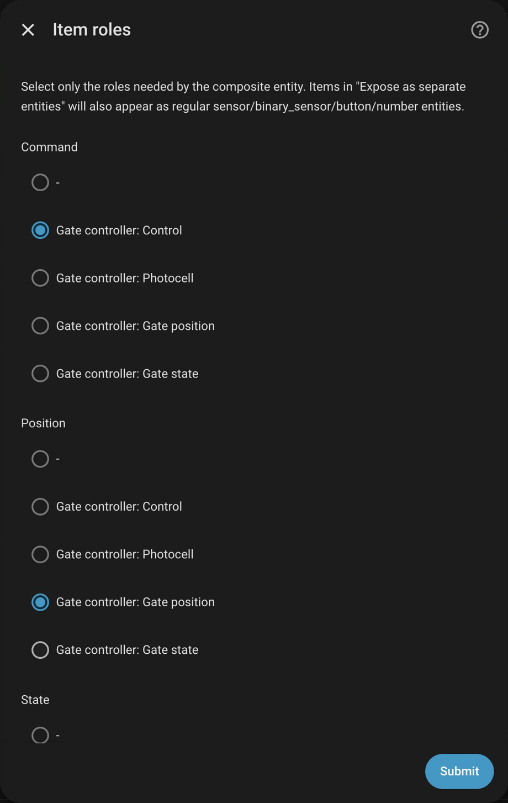

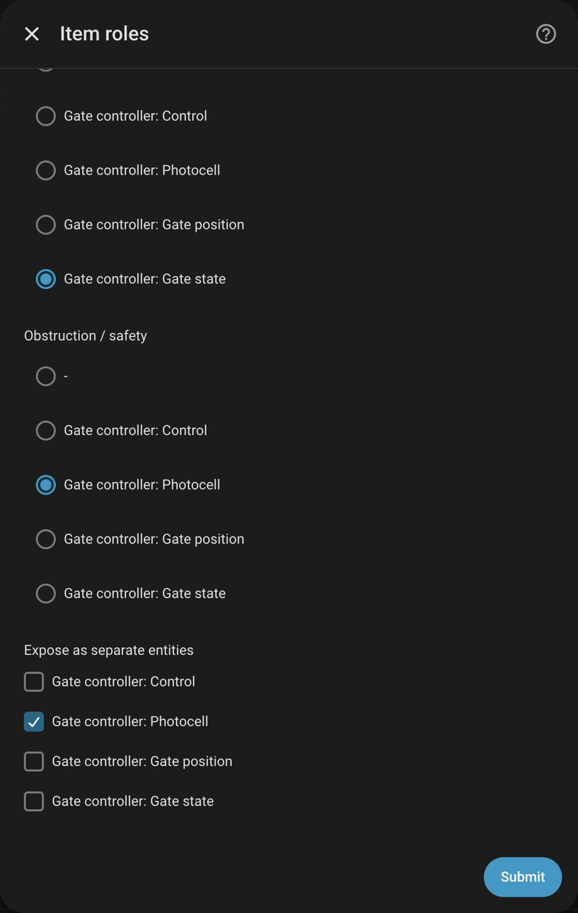

An existing gate device may look like this. A separate photocell remains available for automations.

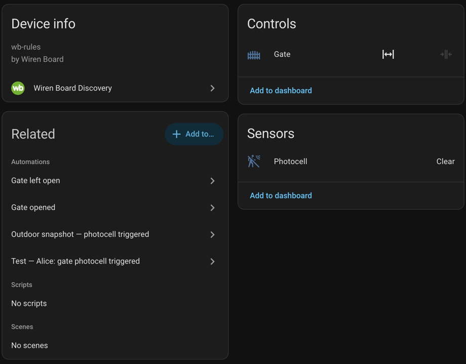

### Thermostats and air conditioners

For **Thermostat** and **AC**, the available roles are:

- current temperature;
- target temperature: a writable setpoint;
- power;
- operating mode;
- fan.

Assign only roles backed by suitable channels. For example, for the R8C-963S, use its main operating mode channel and enum values rather than auxiliary switches for individual modes. Keep some source channels exposed as separate entities if needed.

### Gas and water meters

Choose **Gas meter** or **Water meter** for a group with the corresponding readings. The integration assigns a sensor device class and supports cumulative statistics for numeric readings. It also recognizes `gas` and `water` channel metadata without manually setting a group type.

The units `m^3` and `m3` are normalized to `m³`. Select a cumulative volume channel with the correct units: setting a group type does not convert pulses into cubic meters. Text enum states, such as battery status, remain descriptive sensors.

### Editing, moving, and removing

Use **Edit group** to change the name, type, channels, and roles. Removing a channel from a group also deselects it and removes its standalone entity if no other group uses it. The channel does not automatically return to its original Wiren Board device.

When you move an existing channel into another logical device, the integration moves its entity and cleans up the old device if it becomes empty. **Remove group** also deselects channels that no other group uses. Do not remove a group as a way to keep all its entities separately.

Use **Remove unwanted entities** to remove unwanted standalone channels. Channels used by active groups are excluded from this list. Check any automations using an entity before removing it.

## Binary sensor inversion

If a binary input uses reversed logic, open **Configure → Invert binary sensors**, select the required sensors, and save. Their on and off states will be reversed. The list uses Home Assistant entity names, including names set by users.

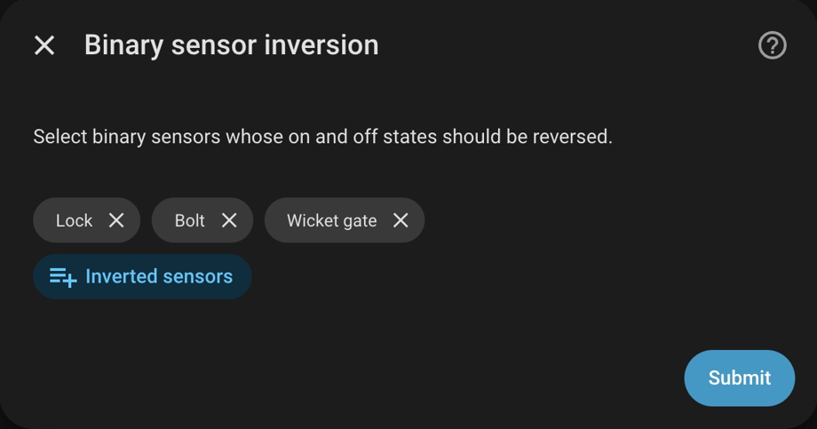

## Sending SMS

### Preparing Wiren Board

You need a working modem, a SIM card that supports sending SMS, and a `wb-rules` rule that accepts commands over MQTT. First verify that SMS sending works on the controller itself.

[examples/send_sms.js](examples/send_sms.js) contains an example rule for this integration. It creates a virtual device named `sms_sender` with these channels:

| Channel | Purpose |
|---|---|
| `send` | A writable text command in the format `number;message`. |
| `last_sent_time` | The time of the most recent attempt, in ISO format. |
| `last_message_text` | The text of the most recent attempt. |
| `last_recipient_number` | The recipient number of the most recent attempt. |
| `last_result` | The result of passing the command to the modem, or an error description. |

For a new rule installation, save the file as `/etc/wb-rules/send_sms.js` on Wiren Board and check that it loads in the rule editor and `wb-rules` log. If another rule already creates `sms_sender`, use the existing compatible rule rather than installing two definitions of the same device.

The rule must call `Notify.sendSMS()`, clear the processed `send` value, and ignore empty strings and whitespace. The example is supplied separately from the Python component; installing the integration through HACS does not install the rule on your controller.

### Home Assistant action

In the automation editor, add **Wiren Board Discovery: Send SMS**, select the Wiren Board connection, and enter a phone number and message. The visual editor provides a connection selector; you do not need to look up its ID manually.

YAML example:

```yaml
action: wirenboard_discovery.send_sms
data:
  config_entry_id: YOUR_CONFIG_ENTRY_ID
  phone: "+79991234567"
  message: "Test SMS message"
```

Replace `YOUR_CONFIG_ENTRY_ID` with your connection entry's ID. The easiest approach is to select the connection in the visual action editor, switch that action to YAML, and copy the populated field.

Specify the number on every call. International numbers beginning with `+` are supported. Russian numbers with 10 digits, or 11 digits starting with `7` or `8`, are normalized to `+7XXXXXXXXXX`. Messages must contain between 1 and 1000 characters; modem and carrier limits apply separately.

The command is published to `/devices/sms_sender/controls/send/on`, using the configured prefix. After a fixed one-second delay, the integration sends a space to the same command topic. This lets `wb-rules` process identical consecutive messages again. Calls within one connection run sequentially.

**A successful action means that the command was published, not that the SMS was delivered to the recipient.** The delay before resetting the command is not a wait for acknowledgment from the script or carrier. Publishing fails if MQTT is unavailable.

### SMS results and diagnostics

The integration creates an **SMS Gateway** device with script availability status, four diagnostic sensors, and an **SMS delivery** event entity with `sent` and `failed` event types. These entities are created for a connection whether or not a modem is present; diagnostic data may be unavailable without a compatible WB rule.

Script availability is determined by receiving the four `last_*` channels, not by a separate modem check or heartbeat. The event contains the recipient, text, result, and time. A result starting with `Ошибка` (Russian for "Error") or `error` also creates a persistent Home Assistant notification.

The `sent` state reflects the result reported by the WB rule and is not itself a carrier delivery report. Old retained values received at startup are used as the initial state and should not trigger notifications again.

## Exporting and importing settings

**Configure → Export configuration** displays JSON containing connection parameters, selected channels, inversion settings, groups, roles, and stored channel metadata. Copy it into a file.

To restore settings, open **Import configuration**, paste the JSON, and submit. Import replaces the corresponding entry settings and reloads the entry. When moving to another Home Assistant installation, create a Wiren Board connection first, then import the settings into it.

The export contains the MQTT password and channel data. Treat it as a configuration file containing credentials; remove the password and personal values before sharing an example publicly.

### YAML grouping file

`/config/wirenboard_discovery.yaml` is a separate way to define channel grouping. It does not replace JSON export or the MQTT setup wizard. Example regular devices:

```yaml
devices:
  living_room_sensors:
    name: "Living room sensors"
    type: device
    controls:
      - "wb-msw-v4_74/Current Temperature"
      - "wb-msw-v4_74/Humidity"

  hallway_relays:
    name: "Hallway relays"
    type: device
    controls:
      - "wb-mr6cu_63/K*"
```

Use actual `<wb_device_id>/<control_id>` keys in `controls`; patterns such as `K*` are supported. This file groups channels that are already selected and does not select additional channels by itself. Reload the integration entry after editing the file.

For composite `cover` and `climate` entities, use UI groups: YAML grouping does not replace their role configuration. If a group ID exists in both places, its UI configuration takes precedence over YAML. The file is shared across connections, so use unambiguous device keys.

## Diagnostics and troubleshooting

Open **Configure → Diagnostics**. The screen shows discovered device and channel counts, selected channels, groups, MQTT messages, parsing errors, `meta/error`, drivers, and WB-STD-001 usage. It is normal for the number of discovered channels to exceed the number of created entities.

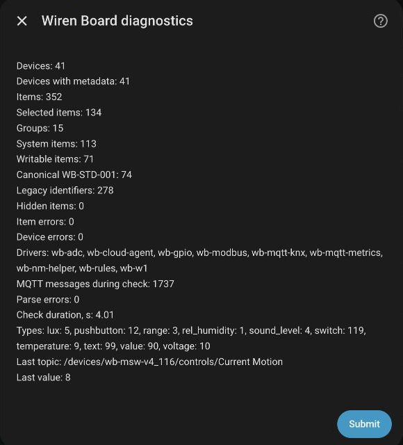

| Problem | What to check |
|---|---|
| The controller was not discovered automatically | Add it manually. Check MQTT and mDNS connectivity between networks; enter settings manually for authentication or a nonstandard port. |
| Connection failed | Check the address, port, credentials, and Home Assistant's access to the broker. Enter the MQTT broker address, not the WB web interface URL. |
| MQTT works, but there are no channels | Check the prefix, retained values and metadata under `/devices/...`, and the MQTT user's access to those topics. |
| A new channel appears in WB, but has no HA entity | Add it by creating or editing a group. New channels are not selected automatically. |
| A channel is hidden | Check the system device type and `hidden: true` metadata. Channels hidden by their publisher are excluded from initial selection. |
| An entity became unavailable | Check the MQTT connection and channel/device `meta/error` values. Availability should recover after the error is resolved. |
| A binary input shows the opposite state | Configure inversion for that sensor. |
| Meter readings are unsuitable for statistics | Check the numeric value, volume unit, and channel or group type. Convert pulses to volume at the source. |
| SMS Gateway has no data | Check the WB rule and publication of all four `last_*` channels. An MQTT connection alone does not prove that the modem is working. |
| The SMS action completed, but no message arrived | Check `last_result`, the `wb-rules` log, modem, SIM card, and carrier. Action completion does not confirm recipient delivery. |

## Standards and compatibility

Both canonical [WB-STD-001](https://github.com/wirenboard/wb-standards) identifiers and legacy human-readable MQTT identifiers are supported. You do not need to rename existing topics to connect.

The integration handles device and channel errors, hidden channels, writable/read-only enums, `unixtime`, write-only switches, and the `precision` step. Published translations are selected according to the Home Assistant language. Availability updates without a full reload for ordinary `meta/error` changes; structural metadata changes to selected channels may reload just the integration entry.

[device_templates](https://github.com/akinin/wirenboard-discovery/tree/main/device_templates) contains a compatible custom R8C-963S template with bilingual labels, corrected units, and a floor temperature channel disabled by default for models without that sensor. Installing it is a separate Wiren Board configuration step.

See [CHANGELOG](https://github.com/akinin/wirenboard-discovery/blob/main/CHANGELOG.md) for release history. To report a problem, open an [Issue](https://github.com/akinin/wirenboard-discovery/issues) with your Home Assistant and integration versions, a description, and diagnostics with passwords and private messages removed.

## Support the project

If you find the integration useful, you can [support its development through Keepz](https://app.keepz.me/pay?qrType=DEFAULT&receiverType=USER&receiverId=3a23e5d1-9569-425b-97c1-2a9e39fb4bd5&lng=en). To donate from your phone, scan the QR code.

<a href="https://app.keepz.me/pay?qrType=DEFAULT&amp;receiverType=USER&amp;receiverId=3a23e5d1-9569-425b-97c1-2a9e39fb4bd5&amp;lng=en">
  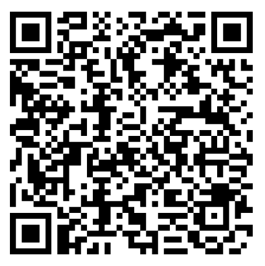
</a>
