[](https://github.com/akinin/wirenboard-discovery/releases/latest)
[](https://spasibomir.ru/pay/22699)

**Язык: Русский (основной) | [English](README.en.md)**

# Wiren Board Discovery для Home Assistant

Интеграция подключает устройства Wiren Board к Home Assistant напрямую через MQTT. Можно выбрать отдельные каналы, объединить их в логические устройства и настроить составные сущности: ворота, шторы, термостаты и кондиционеры.

> Неофициальная интеграция сообщества. Не является продуктом компании Wiren Board и не поддерживается ею.

Инструкция подготовлена для **версии 0.17.3**. Скриншоты сделаны в русскоязычном интерфейсе Home Assistant; названия комнат, устройств и количество объектов в вашей установке будут другими.

## Возможности

- Получение значений и метаданных из MQTT-топиков Wiren Board `/devices/...`.
- Выбор каналов при первоначальном подключении; добавление новых каналов через группы.
- Обычные сущности `sensor`, `binary_sensor`, `switch`, `number`, `select`, `button`, `text` и `datetime`.
- Составные сущности `cover` для ворот и штор, `climate` для термостатов и кондиционеров.
- Логические устройства из каналов одного или нескольких модулей Wiren Board.
- Русские и другие локализованные названия, если устройство публикует соответствующие переводы.
- Распознавание единиц измерения, счётчиков газа и воды, диагностических каналов и ошибок устройств.
- Инверсия бинарных сенсоров и удаление ненужных отдельных сущностей.
- Отправка SMS через модем Wiren Board, диагностические сенсоры и событие результата `event`.
- Экспорт и импорт настроек, экран диагностики MQTT.

## Перед установкой

Нужны Home Assistant **2026.6.0 или новее**, установленный HACS и контроллер Wiren Board с доступным MQTT-брокером.

Home Assistant должен иметь сетевой доступ к брокеру. Подготовьте его адрес, порт, а при включённой авторизации — пользователя и пароль MQTT. Для обнаружения каналов устройства должны публиковать значения и метаданные в MQTT; retained-сообщения позволяют получить их сразу после подключения.

**Отдельная интеграция MQTT в Home Assistant и MQTT bridge для работы Wiren Board Discovery не требуются.** Интеграция сама устанавливает соединение с брокером. Она может использовать брокер Wiren Board параллельно с другими клиентами.

## Установка через HACS

Репозиторий принят в основной каталог HACS. Добавлять его вручную в пользовательские репозитории обычно не нужно.

1. Откройте **HACS** в Home Assistant.
2. В поиске введите **Wiren Board Discovery** и откройте найденную интеграцию автора **akinin**.
3. Нажмите **Загрузить** и установите актуальный стабильный релиз.
4. Перезапустите Home Assistant.
5. Перейдите в **Настройки → Устройства и службы → Добавить интеграцию** и найдите **Wiren Board Discovery**.

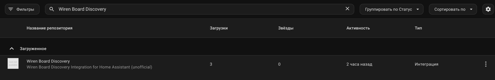

На скриншоте интеграция уже загружена. При новой установке её статус будет другим. Если сразу после включения в каталог поиск ничего не находит, обновите список репозиториев HACS и повторите поиск. В качестве запасного варианта можно добавить `https://github.com/akinin/wirenboard-discovery` через меню **Пользовательские репозитории / Custom repositories**, категория **Integration**.

### Ручная установка

Скачайте исходники нужного [релиза](https://github.com/akinin/wirenboard-discovery/releases) и скопируйте папку `custom_components/wirenboard_discovery` в каталог конфигурации Home Assistant. Итоговый путь должен быть `/config/custom_components/wirenboard_discovery/manifest.json`.

При установке из релизного файла `wirenboard-discovery.zip` распакуйте его содержимое непосредственно в `/config/custom_components/wirenboard_discovery/`: в этом ZIP файлы интеграции лежат в корне. Затем перезапустите Home Assistant и добавьте интеграцию через интерфейс.

## Первое подключение

### Ручное добавление контроллера

Откройте **Настройки → Устройства и службы → Добавить интеграцию → Wiren Board Discovery** и заполните форму:

| Поле | Что указать |
|---|---|
| Адрес контроллера | IP-адрес или DNS-имя MQTT-брокера, доступное из Home Assistant. Не URL веб-интерфейса. |
| Порт MQTT | Обычно `1883`; укажите фактический порт своего брокера. |
| Пользователь MQTT, пароль MQTT | Учётные данные брокера. Если брокер разрешает нужное подключение без авторизации, оставьте поля пустыми. |
| Префикс топиков | Обычно `/`, при котором используются топики `/devices/...`. Меняйте только при иной организации MQTT. |
| Показывать системные устройства | Включите, если при первоначальном выборе нужны системные каналы контроллера. |

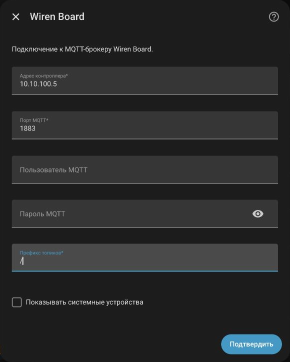

1. Нажмите **Подтвердить** в форме подключения. Интеграция проверит MQTT и соберёт доступные каналы.
2. На экране **Найденные элементы** выберите каналы, которые хотите добавить в Home Assistant.
3. Подтвердите выбор и завершите мастер.

Для первоначальной проверки достаточно выбрать несколько понятных каналов, например температуру, влажность и одно реле. Остальные можно добавить позже через группы. Системные устройства по умолчанию скрыты; каналы с MQTT-метаданными `hidden: true` скрываются отдельно.

Если появляется сообщение **Этот контроллер уже добавлен**, откройте существующую запись интеграции: повторно добавлять то же подключение не нужно.

### Автообнаружение

Home Assistant может обнаружить Wiren Board через mDNS/Zeroconf по объявлению с именем вида `wirenboard-XXXX`. На странице **Устройства и службы** откройте обнаруженную интеграцию кнопкой **Добавить**, затем выберите каналы.

Автообнаружение пробует подключиться к MQTT на порту `1883`, с префиксом `/` и без логина и пароля. Если брокер требует авторизацию, использует другой порт или mDNS недоступен между сетями, используйте ручное добавление.

### Что появится после подключения

Выбранные каналы появятся как сущности Home Assistant и будут объединены по устройствам Wiren Board. Значения обновляются через MQTT. Набор сущностей зависит от типа канала, доступности записи и опубликованных метаданных.

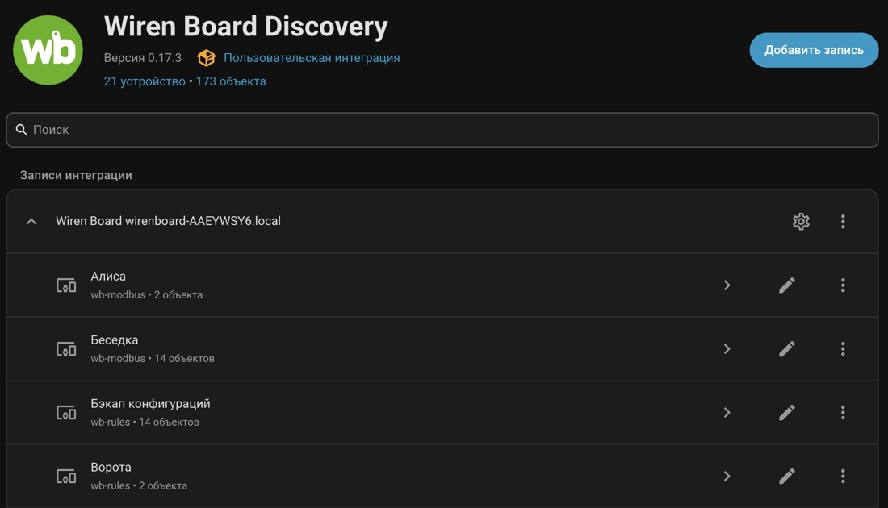

Имена сущностей можно менять штатно в Home Assistant. Интеграция также использует опубликованные названия, модель/драйвер, серийный номер и версии устройства, когда эти данные доступны. Отсутствующие метаданные она не придумывает.

## Настройки интеграции

Откройте страницу **Wiren Board Discovery** и нажмите шестерёнку **Настроить** у нужной записи подключения.

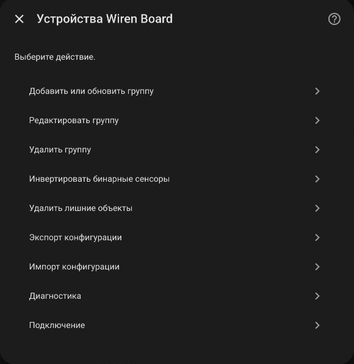

| Пункт | Назначение |
|---|---|
| Добавить или обновить группу | Создать логическое устройство и включить в него каналы, в том числе ранее не выбранные. |
| Редактировать группу | Изменить имя, состав, тип и роли существующей группы. |
| Удалить группу | Удалить группу и исключить её каналы из выбора, если они не используются другими группами. |
| Инвертировать бинарные сенсоры | Поменять местами включённое и выключенное состояния выбранных бинарных сенсоров. |
| Удалить лишние объекты | Удалить отдельные выбранные каналы, которые не входят в действующие группы. |
| Экспорт конфигурации | Скопировать настройки интеграции в JSON. |
| Импорт конфигурации | Заменить настройки данными из JSON. |
| Диагностика | Проверить обнаруженные устройства, MQTT-сообщения, типы каналов и ошибки. |
| Подключение | Изменить адрес, порт, учётные данные и префикс MQTT. |

После сохранения настроек перезагружается запись интеграции. Перезапуск всего Home Assistant для этого обычно не нужен.

## Как добавить новые каналы после установки

Новые MQTT-каналы **не создают сущности автоматически**. Интеграция видит их в текущем MQTT-инвентаре, но включение остаётся явным.

После первоначальной настройки отдельного пункта **Выбрать элементы** в меню нет. Используйте один из вариантов:

- **Добавить или обновить группу** — создайте обычное устройство из нужных новых каналов.
- **Редактировать группу** — добавьте новые каналы в уже существующее устройство.

В поле **Элементы в группе** доступен поиск. Пометка в квадратных скобках, например `[Ворота]`, показывает, что канал уже используется другой группой. Перенос существующего канала может изменить устройство, к которому относится его сущность.

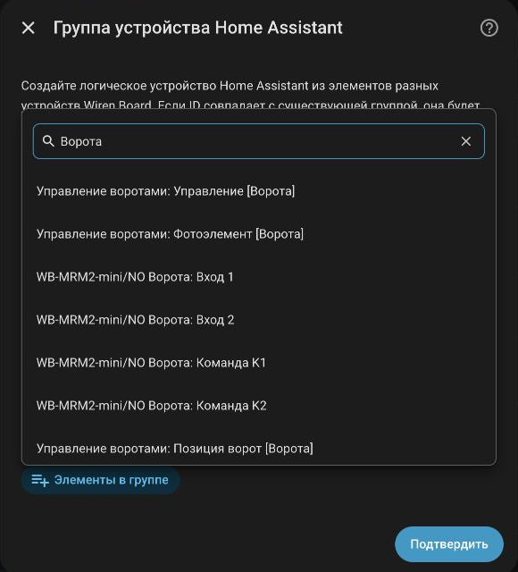

## Логические устройства и составные сущности

### Создание обычного устройства

1. Откройте **Настроить → Добавить или обновить группу**.
2. Укажите **Название устройства**, например `Климат гостиной`.
3. При необходимости задайте **ID группы**, например `living_room_sensors`. Если оставить его пустым, он будет получен из названия. Для новой группы используйте новый ID: совпадение с существующим обновит ту группу.
4. Выберите тип **Device / Обычное устройство**.
5. В **Элементы в группе** выберите каналы одного или нескольких устройств Wiren Board.
6. При необходимости укажите иконку и подтвердите форму.

Обычная группа объединяет отдельные сущности в карточке устройства. Выбор температуры и уставки сам по себе не создаёт термостат: для этого нужен тип **Thermostat / Термостат** и настройка ролей.

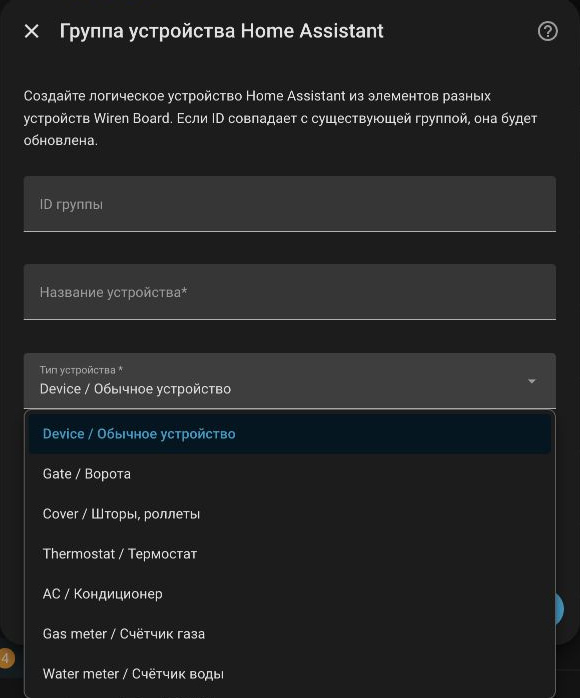

### Ворота и шторы

Выберите тип **Gate / Ворота** или **Cover / Шторы, роллеты**, задайте имя и выберите нужные MQTT-каналы. Первый шаг открывает форму назначения ролей; окончательное сохранение выполняется на следующем шаге.

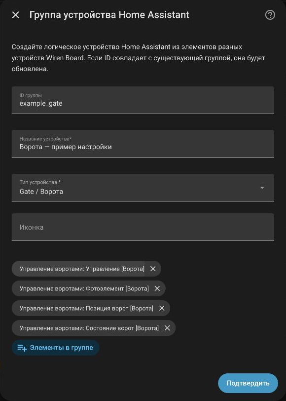

| Роль | Какой канал выбрать |
|---|---|
| Команда | Записываемый канал управления вашим приводом или правилом WB. |
| Позиция | Канал фактического положения в процентах, если он есть. |
| Состояние | Канал, сообщающий об открытии, закрытии и движении. |
| Препятствие / безопасность | Фотоэлемент или другой подходящий канал состояния препятствия. |
| Оставить отдельными сущностями | Каналы, которые нужны и внутри `cover`, и отдельно, например фотоэлемент для автоматизации. |

Ненужную роль можно оставить `-`. Это не создаёт отсутствующий датчик: доступные функции определяются реальными каналами и их значениями. Проверьте совместимость команд с вашим правилом WB: в версии 0.17.3 команды открытия, закрытия и остановки по умолчанию отправляют значение `1` в выбранный командный канал. Это подходит для импульсного управления, но не является универсальным протоколом любого привода.

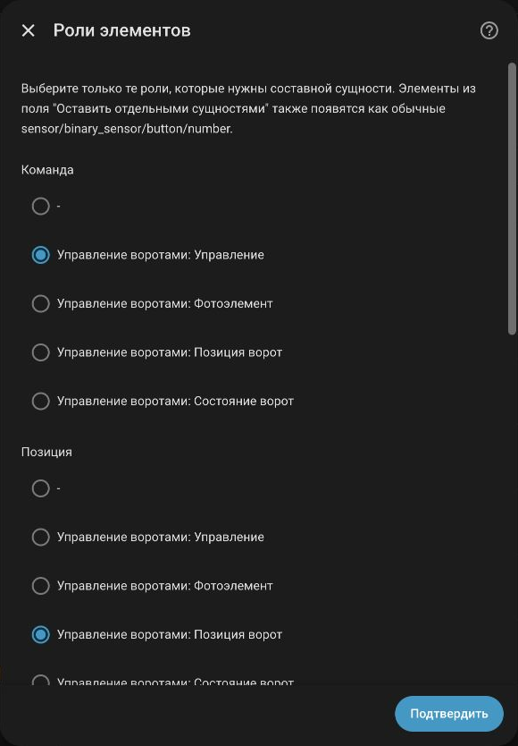

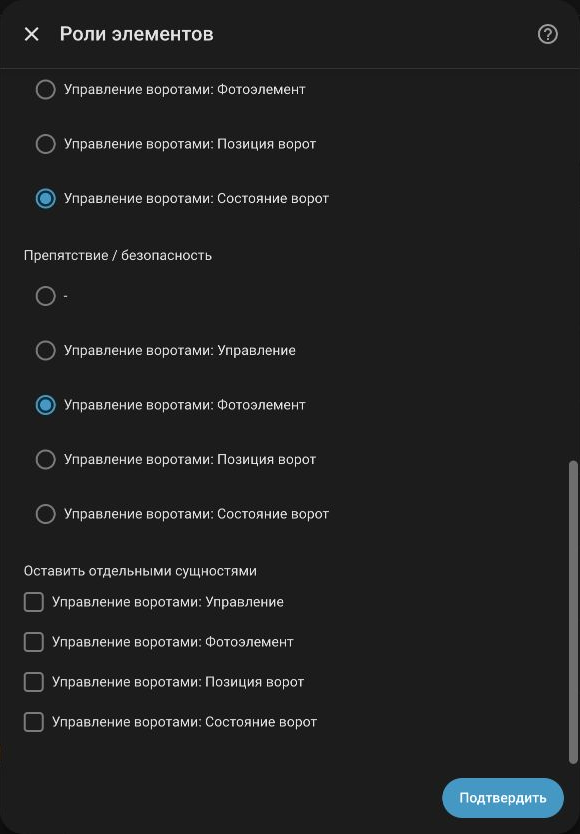

Так может выглядеть уже существующее устройство ворот. Отдельный фотоэлемент остаётся доступен для автоматизаций.

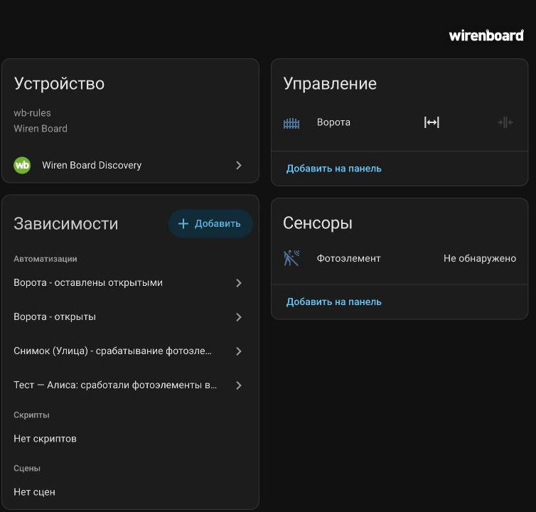

### Термостат и кондиционер

Для типов **Thermostat / Термостат** и **AC / Кондиционер** выбираются роли:

- текущая температура;
- целевая температура — записываемая уставка;
- питание;
- режим работы;
- вентилятор.

Назначайте только роли, для которых есть соответствующие каналы. Например, для R8C-963S используйте основной канал режима работы и его enum-значения, а не вспомогательные переключатели отдельных режимов. При необходимости сохраните часть исходных каналов отдельными сущностями.

### Счётчики газа и воды

Выберите **Gas meter / Счётчик газа** или **Water meter / Счётчик воды** для группы с соответствующими показаниями. Интеграция назначает класс сенсора и поддерживает накопительную статистику числовых показаний. Метаданные каналов `gas` и `water` распознаются также без ручного задания типа группы.

Единицы `m^3` и `m3` приводятся к `m³`. Выбирайте канал накопленного объёма с правильными единицами: назначение типа группы не пересчитывает импульсы в кубометры. Текстовые enum-состояния, например состояние батареи, остаются описательными сенсорами.

### Редактирование, перенос и удаление

Через **Редактировать группу** можно изменить имя, тип, состав и роли. Если канал исключён из группы и не используется другими группами, он исключается из выбора, а его отдельная сущность удаляется. Канал не возвращается автоматически в исходное устройство Wiren Board.

При переносе существующего канала в другое логическое устройство интеграция переносит его сущность и очищает прежнее устройство, если оно стало пустым. **Удалить группу** также исключает её неиспользуемые другими группами каналы. Удаление группы не следует использовать как способ сохранить все её сущности отдельно.

Для удаления лишних отдельных каналов используйте **Удалить лишние объекты**. Каналы действующих групп в этом списке не показываются. Прежде чем удалять сущность, проверьте использующие её автоматизации.

## Инверсия бинарных сенсоров

Если бинарный вход имеет обратную логику, откройте **Настроить → Инвертировать бинарные сенсоры**, выберите нужные сенсоры и сохраните. Для них состояния включено и выключено поменяются местами. В списке используются имена сущностей Home Assistant, включая заданные пользователем.

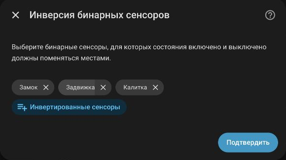

## Отправка SMS

### Подготовка Wiren Board

Нужны работающие модем и SIM-карта с возможностью отправки SMS, а также правило `wb-rules`, принимающее команды из MQTT. Сначала убедитесь, что отправка SMS с самого контроллера настроена.

В [examples/send_sms.js](examples/send_sms.js) приведён пример правила для этой интеграции. Оно создаёт виртуальное устройство `sms_sender` с каналами:

| Канал | Назначение |
|---|---|
| `send` | Записываемая текстовая команда `номер;сообщение`. |
| `last_sent_time` | Время последней попытки в ISO-формате. |
| `last_message_text` | Текст последней попытки. |
| `last_recipient_number` | Номер получателя последней попытки. |
| `last_result` | Результат передачи команды модему или описание ошибки. |

Для новой установки правила сохраните файл как `/etc/wb-rules/send_sms.js` на Wiren Board и проверьте его загрузку в редакторе правил и журнале `wb-rules`. Если устройство `sms_sender` уже создаётся другим правилом, используйте существующее совместимое правило: два определения одного устройства устанавливать не нужно.

Правило должно вызывать `Notify.sendSMS()`, очищать обработанный `send` и игнорировать пустые строки и пробелы. Пример опубликован отдельно от Python-компонента; установка интеграции через HACS сама не устанавливает его на контроллер.

### Действие в Home Assistant

В редакторе автоматизации добавьте действие **Wiren Board Discovery: Send SMS**, выберите подключение Wiren Board, введите номер и сообщение. Выбор подключения выполняется из списка; вручную искать его ID для визуального редактора не нужно.

Пример YAML:

```yaml
action: wirenboard_discovery.send_sms
data:
  config_entry_id: YOUR_CONFIG_ENTRY_ID
  phone: "+79991234567"
  message: "Проверка отправки SMS"
```

`YOUR_CONFIG_ENTRY_ID` замените ID своей записи подключения. Проще выбрать подключение в визуальном редакторе действия, а затем переключить это действие в YAML и скопировать уже заполненное поле.

Номер задаётся при каждом вызове. Поддерживаются международные номера с `+`; российские номера из 10 цифр или 11 цифр с первой `7`/`8` приводятся к `+7XXXXXXXXXX`. Текст сообщения должен содержать от 1 до 1000 символов; ограничения оператора и модема действуют отдельно.

Команда публикуется в `/devices/sms_sender/controls/send/on` с учётом настроенного префикса. Через фиксированную паузу в одну секунду интеграция отправляет в этот же командный топик пробел. Это позволяет `wb-rules` повторно обработать полностью одинаковое SMS. Вызовы внутри одного подключения выполняются последовательно.

**Успешный вызов действия означает публикацию команды, а не подтверждение доставки SMS получателю.** Пауза перед сбросом не является ожиданием подтверждения от скрипта или оператора. Если MQTT недоступен, публикация завершается ошибкой.

### Результат и диагностика SMS

Интеграция создаёт устройство **SMS Gateway** с состоянием доступности скрипта, четырьмя диагностическими сенсорами и событием **Отправка SMS** типов `sent` и `failed`. Эти сущности создаются для подключения независимо от наличия модема; без совместимого WB-правила диагностические данные могут отсутствовать.

Доступность скрипта определяется получением четырёх `last_*`-каналов, а не отдельной проверкой модема или heartbeat. Событие содержит получателя, текст, результат и время. При результате, начинающемся с `Ошибка` или `error`, создаётся также постоянное уведомление Home Assistant.

Состояние `sent` отражает результат, сообщённый WB-правилом, и само по себе не является отчётом оператора о доставке. Старые retained-значения при запуске используются как исходное состояние и не должны повторно создавать уведомления.

## Экспорт и импорт настроек

**Настроить → Экспорт конфигурации** выводит JSON с параметрами подключения, выбранными каналами, инверсией, группами, ролями и сохранёнными описаниями каналов. Скопируйте его в файл.

Для восстановления откройте **Импорт конфигурации**, вставьте JSON и подтвердите. Импорт заменяет соответствующие настройки записи и перезагружает её. При переносе на другую установку Home Assistant сначала создайте подключение Wiren Board, затем импортируйте настройки в него.

Экспорт содержит MQTT-пароль и данные каналов. Храните его как конфигурационный файл с учётными данными; перед публикацией примера уберите пароль и личные значения.

### YAML-файл группировки

Файл `/config/wirenboard_discovery.yaml` — отдельный способ задать группировку каналов. Он не заменяет JSON-экспорт и мастер MQTT-подключения. Пример обычных устройств:

```yaml
devices:
  living_room_sensors:
    name: "Гостиная: датчики"
    type: device
    controls:
      - "wb-msw-v4_74/Current Temperature"
      - "wb-msw-v4_74/Humidity"

  hallway_relays:
    name: "Прихожая: реле"
    type: device
    controls:
      - "wb-mr6cu_63/K*"
```

В `controls` используются реальные ключи `<wb_device_id>/<control_id>`; допускаются шаблоны, например `K*`. Файл группирует уже выбранные каналы и сам по себе не включает новые каналы в выбор. После изменения перезагрузите запись интеграции.

Для составных `cover` и `climate` используйте группы интерфейса: YAML-группировка не заменяет их настройку ролей. При совпадении ID группы настройки этой группы из интерфейса имеют приоритет над YAML. Для нескольких подключений файл общий, поэтому используйте однозначные ключи устройств.

## Диагностика и частые вопросы

Откройте **Настроить → Диагностика**. Экран показывает количество обнаруженных устройств и каналов, выбранные каналы, группы, MQTT-сообщения, ошибки парсинга, `meta/error`, драйверы и использование WB-STD-001. Количество найденных каналов может быть больше количества созданных сущностей — это нормально.

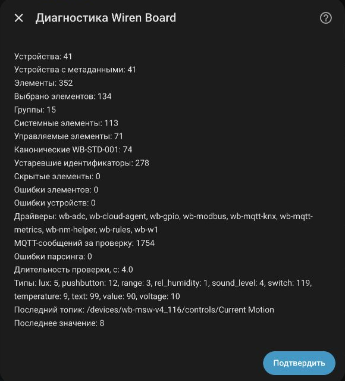

| Проблема | Что проверить |
|---|---|
| Контроллер не появился автоматически | Используйте ручное добавление. Проверьте доступность MQTT и mDNS между сетями; для авторизации или нестандартного порта вводите параметры вручную. |
| Не удалось подключиться | Проверьте адрес, порт, учётные данные и доступ Home Assistant к брокеру. Вводить нужно адрес MQTT-брокера, а не URL веб-интерфейса WB. |
| MQTT работает, но каналов нет | Проверьте префикс, retained-значения и метаданные `/devices/...`, а также доступ MQTT-пользователя к этим топикам. |
| Новый канал виден в WB, но сущности в HA нет | Добавьте его через создание или редактирование группы. Новые каналы не включаются автоматически. |
| Канал скрыт | Проверьте системный тип устройства и метаданные `hidden: true`. Скрытые издателем каналы не предлагаются в первоначальном выборе. |
| Сущность стала недоступна | Проверьте подключение MQTT и ошибки `meta/error` канала и устройства. После устранения ошибки доступность должна восстановиться. |
| Бинарный вход показывает обратное состояние | Настройте инверсию этого сенсора. |
| Показания счётчика не подходят для статистики | Проверьте числовое значение, единицу объёма и тип канала или группы. Импульсы нужно преобразовать в объём на стороне источника. |
| Нет данных SMS Gateway | Проверьте WB-правило и публикацию четырёх `last_*`-каналов. Наличие MQTT-соединения само по себе не подтверждает работу модема. |
| Действие SMS выполнилось, но сообщение не пришло | Проверьте `last_result`, журнал `wb-rules`, модем, SIM-карту и оператора. Выполнение действия не подтверждает доставку получателю. |

## Стандарты и совместимость

Поддерживаются канонические идентификаторы [WB-STD-001](https://github.com/wirenboard/wb-standards) и прежние человекочитаемые MQTT-идентификаторы. Переименовывать существующие топики ради подключения не требуется.

Интеграция учитывает ошибки устройства и канала, скрытые каналы, writable/read-only enum, `unixtime`, write-only переключатели и шаг `precision`. Опубликованные переводы выбираются по языку Home Assistant. Доступность обновляется без полной перезагрузки при обычных изменениях `meta/error`; изменения структурных метаданных выбранных каналов могут перезагрузить только запись интеграции.

В [device_templates](https://github.com/akinin/wirenboard-discovery/tree/main/device_templates) есть совместимый пользовательский шаблон R8C-963S с двуязычными подписями, исправленными единицами и отключённым по умолчанию каналом температуры пола для комплектации без датчика. Его установка — отдельная настройка Wiren Board.

История версий — в [CHANGELOG](https://github.com/akinin/wirenboard-discovery/blob/main/CHANGELOG.md). Для сообщения об ошибке используйте [Issues](https://github.com/akinin/wirenboard-discovery/issues), указав версии Home Assistant и интеграции, описание проблемы и диагностические данные без паролей и личных сообщений.
